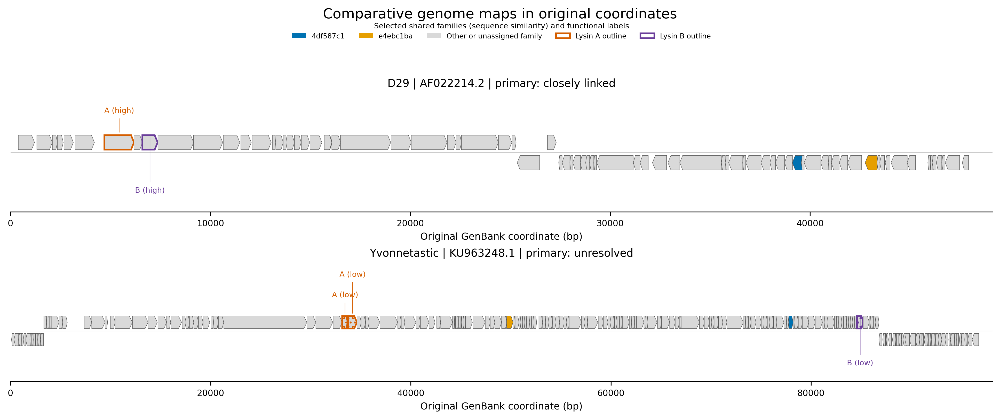

# Actinobacteriophage lysis architecture

Comparative genomics of lysis-gene organization, functional-identification uncertainty and the feasibility of testing neighborhood conservation.

## Summary

The expanded exploratory screen contains **50 complete genomes, 25 reported clusters and 5,915 verified CDS translations**. Under the unchanged 39-reference classifier, 21 genomes have A-family assignments, 15 have B-family assignments and six have both. **Five genomes have a uniquely resolved, closely linked A/B pair; no uniquely resolved separated pair is recovered.** The other architectures are complex in two genomes and unresolved in 43.


*Counts are conditional on this cohort, panel and evidence criteria. A/B categories overlap. Unresolved identification does not establish gene absence. [Caption, sources and checksums](results/exploratory50_v1/figures/figure_manifest.json); [vector PDF](results/exploratory50_v1/figures/exploratory_detection_architecture.pdf).*

The expanded screen adds four linked pairs to the fixed 20-genome baseline. John316 has two predicted A candidates separated from its B candidate by 13 and 14 intervening CDS, but remains complex under the fixed unique-pair definition. No eligible unique separated pair is available for the primary neighborhood-conservation comparison. Evolutionary mechanisms remain unresolved. The release supports descriptive architecture and identification results: [full results](docs/exploratory_screen_results.md), [scientific tables](results/exploratory50_v1/) and [versioned analyses](docs/milestones.md).

## Background

Characterized Lysin A proteins act on peptidoglycan; characterized Lysin B proteins can cleave mycolate-containing envelope linkages. Both groups are heterogeneous, and deposited names or neighboring genes alone cannot establish biochemical function.

Separated arrangements of annotated lysis genes are reported in [Yvonnetastic](https://doi.org/10.1128/genomeA.00594-16) and comparative studies of [Gordonia phages](https://doi.org/10.1128/mBio.01069-17). The question here is whether neighborhoods around independently supported separated B-family genes retain excess conservation relative to matched genomic backgrounds. Functional anchors and sufficient lineage replication are prerequisites for that comparison.



*Original 20-genome baseline: D29 recovers the linked control; the displaced Yvonnetastic arrangement is recovered from annotations with low functional confidence. Shared-family colors and annotation outlines are different evidence. [Original figure manifest](results/reports/figure_manifest.json); [vector PDF](figures/figure_03_genome_maps.pdf).*

## Methodology

The 50-record cohort preserves all 20 pilot accession versions and source checksums. Deterministic sampling uses seed `20261016`, host-genus strata and reported cluster labels. The expanded cohort contains 25 Mycobacterium-host and 25 Gordonia-host phages. Cluster labels and near-identical sequence groups are ancestry proxies, rather than reconstructed phylogenies.


A/B family assignments in the high/moderate scope require **at least 40% identity, at least 70% coverage of both proteins and E-value at most 10^-6**. Weaker reported alignments remain in the hit ledger. Evidence tiers retain their original confidence caps. Published computational predictions, generic lipolytic assays and antimycobacterial assays do not individually establish native lysis-substrate specificity. Genomic proximity never upgrades functional confidence.

A resolved architecture requires one nonpartial A-family and one nonpartial B-family candidate in the high/moderate evidence scope. Separation requires **more than four intervening CDS**; sensitivity cutoffs are two, six and ten. Multiple candidates remain complex and incomplete identifications remain explicit. [Screen protocol](docs/exploratory_screen_protocol.md), [identification methods](docs/methods.md) and [reference evidence](docs/lysterase_update_results.md) provide the definitions.

The original pilot executes the nine-stage workflow. The expanded exploratory screen executes acquisition through architecture classification, stages 1–5. It does not perform the gated neighborhood-conservation analysis.

## Results

| Observation | Fixed pilot | Expanded exploratory screen |
|---|---:|---:|
| Genomes included | 20 | 50 |
| Verified CDS translations | 2,460 | 5,915 |
| Unique linked A/B pairs, 39-reference panel | 1 | 5 |
| Unique separated A/B pairs | 0 | 0 |

All 50 selected records passed the implemented QC checks. A canonical 21-mer sketch screen yields 47 near-identical screening groups; these are not ANI estimates or independent evolutionary replicates. Primary architecture classes are unchanged across all four separation cutoffs.


*Original CDS order and strand on a shared scale relative to the A-family CDS start. D29 has one intervening CDS; the other four pairs overlap by one nucleotide. Colors show category assignments, rather than identical sequences or experimentally established activity in every genome. [Figure sources and caption](results/exploratory50_v1/linked_contexts/figure_manifest.json); [vector PDF](results/exploratory50_v1/linked_contexts/linked_architectures.pdf).*

The four additional pairs occur in Dewey and Hail, reported cluster Q, and Typha and AuntGwenStacy, reported cluster Y. These are moderate-confidence homology assignments. John316 has two A-family candidates and one B-family candidate: both component pairs are separated, by 13 and 14 intervening CDS. All three assignments transfer from published profile predictions and lack independent functional validation. Sticker17 has two A-family candidates and no supported B-family candidate. Both genomes retain their complex classification. [Component distances and evidence](docs/exploratory_screen_results.md#complex-separated-candidate).

Seven query proteins are exact sequence aliases of reference-panel proteins. Reference overlap and within-cluster similarity prevent these observations from serving as independent functional validation. The [complete hit ledger](results/exploratory50_v1/all_reference_hits.tsv) and [per-CDS detection status](results/exploratory50_v1/protein_detection_status.tsv) retain reported matches, rejected criteria, unresolved proteins and reference aliases.

Earlier analyses remain scoped to their own cohorts and panels: the [pilot](docs/results.md), [reference expansion](docs/amendment_results.md), [held-out profile evaluation](docs/lysb_profile_update_results.md), [annotation-conditioned neighborhoods](docs/annotation_neighborhood_results.md), [assay-source architectures](docs/reference_architecture_results.md), [displaced-candidate audit](docs/displaced_lysB_candidate_audit.md) and [GMA6 substrate and homolog audits](docs/gma6_arabinanase_audit.md). The [six original pilot figures](figures/) retain their source tables and captions.

## Project layout

```text
config/                         Scientific settings and fixed thresholds
src/actinolysis/                 Acquisition, QC, identification and analysis
scripts/                        Numbered stages, audits and reproduction tools
references/                     Curated protein and literature evidence
results/exploratory50_v1/        Expanded tables, figures and checksums
results/lysterase_update/        Frozen reference panel and its evaluation
figures/                        Six original pilot figures
docs/                           Methods and cohort-specific results
tests/                          Software checks and synthetic test fixtures
```

## Reproducibility

Run in Linux or WSL with the pinned Python requirements and MMseqs2 release:

```bash
bash scripts/bootstrap_wsl.sh
.venv/bin/python -B scripts/reproduce_exploratory_screen.py --workspace public_reproduction
.venv/bin/python -B -m pytest -q
```

The public reproduction tool reads the published 50-record manifest, retrieves exact genome and reference accession versions, verifies source checksums and reruns stages 1–5. It uses the published cohort directly and requires no original eligibility frame or preparation workspace. A changed or unavailable source stops reproduction; no replacement genome or refreshed annotation is substituted. [Reproduction details](docs/exploratory_screen_results.md#reproduction) distinguish source retrieval from software installation.

The original isolated replay reproduces **22 scientific artifacts byte for byte**. A [fresh-source reproduction](results/exploratory50_v1/public_reproduction.json) independently retrieves all 77 source records and matches the 16 public scientific tables and summaries, using the same pinned software. Plotted source tables, captions and checksums accompany both expanded-cohort figures. The [artifact manifest](results/exploratory50_v1/artifact_manifest.json) identifies the frozen scientific tables.

## References

- Payne and Hatfull (2012). Mycobacteriophage endolysins and their diverse domain organizations. [Primary study](https://doi.org/10.1371/journal.pone.0034052).
- Yvonnetastic genome announcement (2016). [Primary report](https://doi.org/10.1128/genomeA.00594-16).
- Pope and colleagues (2017). Comparative genomics of Gordonia phages. [Primary study](https://doi.org/10.1128/mBio.01069-17).
- Pollenz, Bland and Pope (2022). Gordonia phage lysis-cassette analysis. [Primary study](https://doi.org/10.1371/journal.pone.0276603).

Additional assays, evidence depth and sequence mappings are recorded in the [literature ledger](references/literature_audit.tsv) and [reference catalogue](results/lysterase_update/panel/references/protein_controls.tsv).

## Citation and license

Citation metadata are provided in [CITATION.cff](CITATION.cff). Original software and documentation use the [MIT license](LICENSE). Upstream records and publications retain their own terms; [data provenance](docs/data_provenance.md) records the sources and reuse scope.
