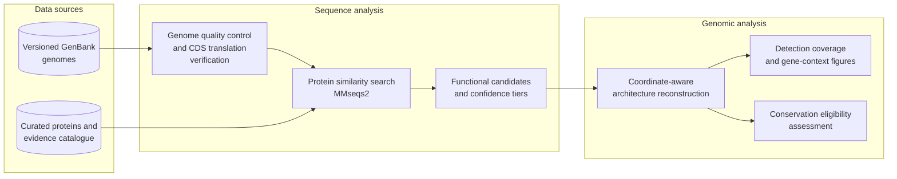
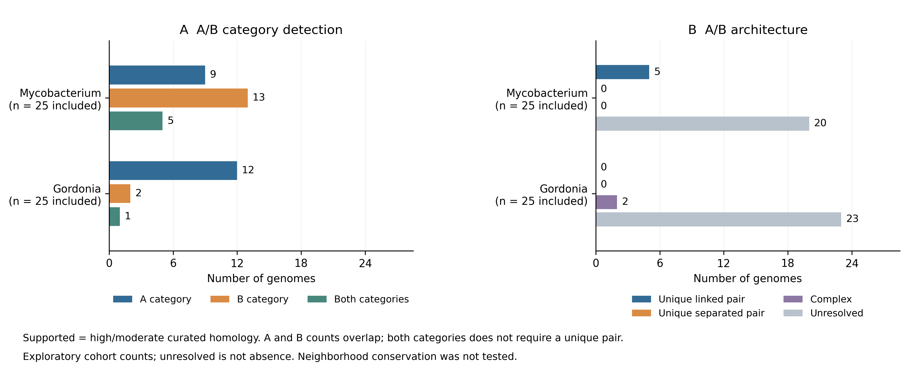
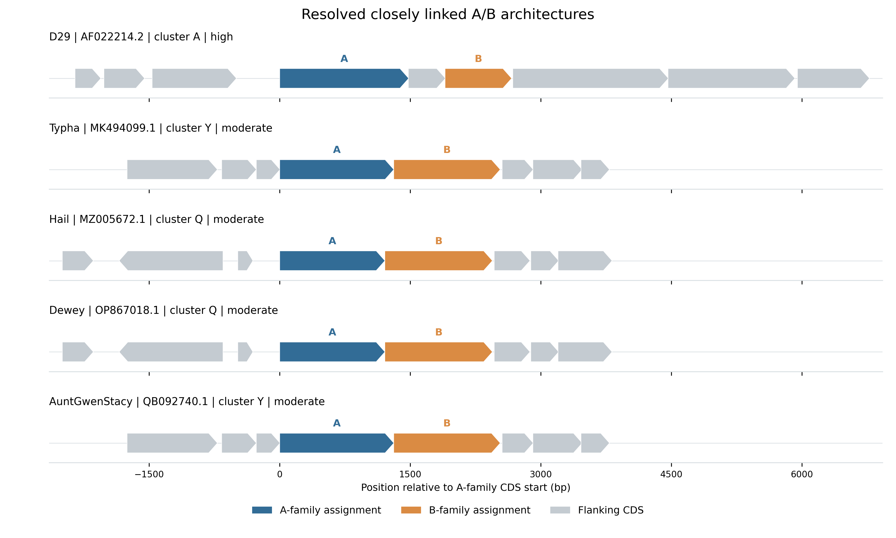

# Actinobacteriophage lysis architecture

A comparative genomic study of lysis-gene organization in phages infecting *Mycobacterium* and *Gordonia*, with explicit treatment of functional uncertainty, shared ancestry and genomic-neighborhood conservation.

## Background and research question

Phages infecting mycolic-acid-containing bacteria can encode Lysin A proteins that degrade peptidoglycan and Lysin B proteins that cleave mycolate-containing envelope linkages. These components may occur together or at separated genomic positions. Their sequence diversity and uneven experimental characterization make deposited gene names an uncertain basis for comparing lysis systems.

Separated arrangements of annotated lysis genes have been reported in [Yvonnetastic](https://doi.org/10.1128/genomeA.00594-16) and broader studies of [Gordonia phages](https://doi.org/10.1128/mBio.01069-17). This study asks how lysis-associated genes are organized, whether separated B-family genes retain conserved neighborhoods beyond general genome synteny, and how identification uncertainty affects those conclusions.

## Data and methods

The study cohort comprises **50 complete GenBank genomes**, including 25 Mycobacterium-host and 25 Gordonia-host phages across **25 reported cluster labels**. Deterministic selection uses host-genus strata, cluster representation and seed `20261016`. Accession versions and source checksums fix the analyzed records. Genome completeness, sequence content, CDS coordinates and deposited translations are checked before protein searches. [Dataset provenance](docs/data_provenance.md) records the sources and selection scope.



A curated panel of **39 reference proteins** supports sequence-based identification. High/moderate A/B assignments require at least **40% identity, 70% coverage of both proteins and E-value at most 10^-6**. Published computational predictions, generic lipolytic assays and antimycobacterial assays retain a moderate confidence ceiling, including exact matches. Deposited annotations are retained separately, and genomic proximity never upgrades functional confidence.

A resolved architecture requires one nonpartial A-family and one nonpartial B-family candidate in the high/moderate evidence scope. A pair is separated when more than four CDS intervene; cutoffs of two, six and ten assess sensitivity. Multiple candidates remain complex, while insufficient identification remains unresolved. Original coordinates, strand, overlaps and record boundaries are preserved.

The conservation framework compares B-neighborhood Jaccard similarity with matched non-lysis anchors in the same genome pairs. Contrasts are averaged within clusters, with at least five contributing clusters required for inference. Eligibility depends on resolved architectures, usable homologous anchors and sufficient replication. [Methods](docs/methods.md) and [statistical assumptions](docs/statistical_assumptions.md) describe the definitions, background matching and inference requirements.

## Results

All 50 selected records pass the implemented QC checks, yielding **5,915 verified CDS translations**. A-family assignments occur in 21 genomes, B-family assignments in 15, and both categories in six. The architecture classification yields **five unique linked pairs, no unique separated pair, two complex architectures and 43 unresolved genomes**. These primary classes are unchanged across all four separation cutoffs.



*A/B detection categories overlap; architecture classes partition the cohort. Counts are conditional on the selected genomes, reference panel and evidence criteria. Unresolved identification does not establish gene absence. [Caption, source tables and checksums](results/exploratory50_v1/figures/figure_manifest.json); [vector PDF](results/exploratory50_v1/figures/exploratory_detection_architecture.pdf).*

The five uniquely resolved linked pairs occur in three reported clusters. One has a single intervening CDS; the other four overlap by one nucleotide and have moderate-confidence homology assignments.



*CDS order and strand are shown on a shared scale relative to the A-family CDS start. Colors indicate category assignments, rather than identical sequences or experimentally established activity in every genome. [Caption and source tables](results/exploratory50_v1/linked_contexts/figure_manifest.json); [vector PDF](results/exploratory50_v1/linked_contexts/linked_architectures.pdf).*

One complex architecture contains separated A/B component pairs, but multiple A candidates prevent a unique-pair classification. Its assignments derive from profile-predicted references and lack independent functional validation. This preserves evidence of separation without supplying an eligible primary conservation comparison.

The [detailed results](docs/exploratory_screen_results.md) and [scientific tables](results/exploratory50_v1/) provide component distances, confidence tiers and sensitivity results. The [complete alignment ledger](results/exploratory50_v1/all_reference_hits.tsv) and [per-CDS detection status](results/exploratory50_v1/protein_detection_status.tsv) retain weaker matches, unresolved proteins and reference-sequence aliases.

## Interpretation and limitations

The analysis supports descriptive comparisons of architecture and identification coverage. It does not provide an estimable primary conservation effect, confidence interval or p-value: the cohort lacks eligible, uniquely resolved separated pairs and sufficient replicated functional anchors. Similarity, proximity and annotation alone do not establish native biochemical function, shared regulation, gene loss or recurrent evolutionary reorganization.

Reference overlap and related genomes limit independent validation. Cluster labels and sequence-similarity screening provide ancestry proxies rather than reconstructed phylogenies. The selected cohort is not a random ecological sample. Divergent or poorly annotated proteins may remain undetected, so unresolved architectures must remain distinct from biological absence. [Scientific limitations](docs/limitations.md) describe the scope of these conclusions.

## Reproducibility

Use Linux or WSL with Python 3.14.4, the pinned Python requirements and MMseqs2 release 18-8cc5c:

```bash
bash scripts/bootstrap_wsl.sh
.venv/bin/python -B scripts/reproduce_exploratory_screen.py --workspace public_reproduction
.venv/bin/python -B -m pytest -q
```

The reproduction command retrieves exact genome and reference accession versions, verifies their checksums and reruns acquisition through architecture classification for the published cohort. It requires no original eligibility frame or preparation workspace. Missing or changed source records stop the run rather than trigger replacement sampling.

Fresh-source and public GitHub-checkout reproductions match the scientific outputs under the pinned software. These checks reuse the installed software environment; independent environment reinstallation is not claimed. [Reproduction details and reports](docs/exploratory_screen_results.md#reproduction) document the measured comparisons. Figures have 300 dpi PNGs, vector PDFs, plotted source tables and caption/checksum manifests.

## Project layout

```text
config/                         Scientific settings and thresholds
data/manifests/                 Versioned input records and checksums
references/                     Curated protein and literature evidence
src/actinolysis/                 Acquisition, QC, identification and analysis
scripts/                        Pipeline and reproduction entry points
results/exploratory50_v1/        Cohort tables, figures and checksums
figures/                        Comparative figures from the 20-genome analysis
docs/                           Methods, results and scientific limitations
tests/                          Software checks and synthetic test fixtures
```

## References

- Payne and Hatfull (2012). Mycobacteriophage endolysins and their diverse domain organizations. [Primary study](https://doi.org/10.1371/journal.pone.0034052).
- Yvonnetastic genome announcement (2016). [Primary report](https://doi.org/10.1128/genomeA.00594-16).
- Pope and colleagues (2017). Comparative genomics of Gordonia phages. [Primary study](https://doi.org/10.1128/mBio.01069-17).
- Pollenz, Bland and Pope (2022). Gordonia phage lysis-cassette analysis. [Primary study](https://doi.org/10.1371/journal.pone.0276603).

Additional assays and sequence mappings are recorded in the [literature ledger](references/literature_audit.tsv) and [reference catalogue](results/lysterase_update/panel/references/protein_controls.tsv).

## Citation and license

Citation metadata are provided in [CITATION.cff](CITATION.cff). Original software and documentation use the [MIT license](LICENSE). Upstream records and publications retain their own terms; [data provenance](docs/data_provenance.md) records the sources and reuse scope.
