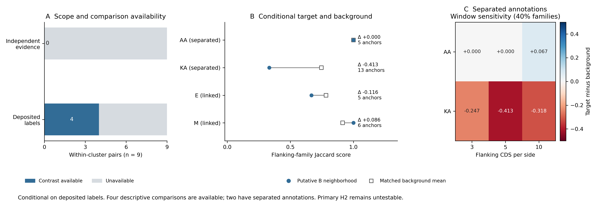

# Neighborhood sensitivity to deposited annotations

Conditioning on deposited lysis labels makes four of nine within-cluster genome pairs available for descriptive matched comparison. Two pairs have separated annotations and two have linked annotations. The independent high/moderate analysis still has no eligible contrast. The [secondary protocol](annotation_neighborhood_protocol.md) keeps these evidence scopes separate and retains the original matching rules.

## Base comparisons

The base configuration uses 40% identity protein families, five flanking CDS per side and the four-intervening-CDS separation cutoff. All contrasts require at least five covariate-matched homologous background anchors.

| Genome pair | Cluster label | Deposited architecture | Target Jaccard | Background mean | Conditional difference | Background anchors |
|---|---|---|---:|---:|---:|---:|
| Phrappuccino–Settecandela | AA | Separated | 1.000 | 1.000 | 0.000 | 5 |
| VanLee–Colossa | KA | Separated | 0.333 | 0.746 | −0.413 | 13 |
| Contagion–Balomoji | E | Linked | 0.667 | 0.783 | −0.116 | 5 |
| IPhane7–Glaske16 | M | Linked | 1.000 | 0.914 | +0.086 | 6 |

For AA, perfect conservation of the putative B neighborhood coincides with perfect conservation of the selected background neighborhoods. The KA target neighborhood has lower family-content similarity than its matched background. The equal-weight mean conditional difference across the two separated cluster labels is −0.206. Background anchors can overlap and are not independent biological replicates. Two coarse cluster labels do not establish an evolutionary sampling distribution.

The remaining pairs are unavailable under unchanged rules: AF supplies only two matched background anchors; CP and T lack a unique deposited B label in both genomes; CR has complex annotation architectures; DC belongs to the same near-identical screening group. These are comparison exclusions rather than gene-absence statements. [All base outcomes](../results/annotation_neighborhood_sensitivity/base_scope_comparison.tsv), [selected background anchors](../results/annotation_neighborhood_sensitivity/conditional_controls.tsv).

## Sensitivities and evidence scope

AA has zero Jaccard contrast at windows of three and five CDS, but +0.067 at ten CDS across the three family thresholds. KA remains negative across those family/window settings, with the precise contrast and number of controls varying. The secondary signed-order contrasts at the base setting are 0.000 for AA and −0.323 for KA. Both metrics, four separation cutoffs and the representative-genome subset are retained in the [complete score table](../results/annotation_neighborhood_sensitivity/conditional_pair_scores.tsv) and [cluster summaries](../results/annotation_neighborhood_sensitivity/conditional_cluster_summary.tsv). No favorable configuration is selected as a replacement result.



These measurements condition on deposited functional labels, which can incorporate genomic context and shared annotation practices. They therefore do not independently validate LysB function or the primary conservation hypothesis. There are no formal p-values or bootstrap confidence intervals in this sensitivity analysis. The primary H2 effect remains unestimable, and no inference about selection, rearrangement mechanism or independent origin follows.

The [vector figure](../results/annotation_neighborhood_sensitivity/comparison/annotation_contrasts.pdf) and [figure/source manifest](../results/annotation_neighborhood_sensitivity/comparison/figure_manifest.json) accompany the raw conditional contrasts. Functional confidence fields and the earlier architecture results are unchanged.

## Reproduction

After reproducing the 39-reference cohort:

```sh
python -B scripts/annotation_neighborhood_sensitivity.py \
  --root .experiments/lysterase_2026 \
  --out .experiments/annotation_sensitivity_rescan
python -B scripts/summarize_annotation_sensitivity.py
```

The [scientific manifest](../results/annotation_neighborhood_sensitivity/sensitivity_report.json) records input and output checksums. Inputs are authenticated against pipeline receipts, and the existing protein-family table must match the frozen cohort analysis. A rescan uses a new output directory; changed scientific inputs or code require a separate freeze.
