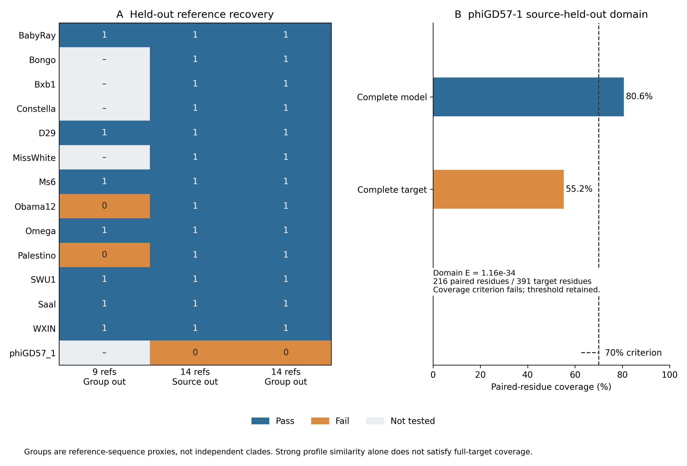

# Expanded assay-profile results

The fourteen-reference broad model recovers 13/14 assay-reference sequences under both source-held-out and similarity-group-held-out evaluation. It evaluates all 2,460 cohort CDS without changing the 39-reference functional catalogue or architecture results. Twenty-seven full and held-out models use the unchanged scoring functions, fixed search space and coverage criteria specified in the [follow-up protocol](lysb_profile_update_protocol.md).

## Reference recovery

| Training panel | Source-held-out recovery | Similarity-group-held-out recovery |
|---|---:|---:|
| Original nine assay references | 9/9 | 7/9 |
| Fourteen assay references | 13/14 | 13/14 |

Every original reference query passes the updated broad-model holdout criteria, including Obama12 and Palestino, which failed whole-target coverage in the original group-held-out analysis. The expanded panel defines seven reference-only similarity groups. Group membership is recomputed from each reference panel; these comparisons do not establish phylogenetic independence or a population sensitivity estimate. [Paired query outcomes](../results/lysb_profile_update/comparison/paired_reference_recovery.tsv).

Bongo passes both updated holdout regimes. Its recovery is consistent with the earlier profile candidates, while pairwise source-held-out matching misses the fixed identity cutoff in the assay-reference update. This is one reference-family observation rather than a broad estimate of model performance.

The remaining held-out failure is phiGD57-1, a 391-residue reference. Its strongest reported domain has independent E = 1.16e-34, 80.6% model coverage and 55.2% full-target coverage. The 216 paired residues fail the prespecified 70% target criterion. The source- and group-held-out failures involve the same query and training exclusion. Domains are not combined and the threshold is retained. Strong profile similarity therefore remains distinct from acceptance of a complete protein under this protocol. [Failure measurements](../results/lysb_profile_update/comparison/held_out_failures.tsv).



## Cohort and specificity observations

The broad full model yields five passing CDS: D29, the two M1 occurrences of the Bongo sequence, and the two E candidates. D29 and both M1 CDS are exact training-sequence aliases, leaving two non-training candidate CDS with two sequences, Contagion and Balomoji. The change from four to two non-training candidates relative to the original model reflects Bongo's inclusion in training; it is not loss of M1 profile detection.

The narrow D29/Ms6 model retains the same two non-training M1 CDS, representing one sequence. Neither full model produces a qualifying cross-family flag among the three selected cellular-enzyme challenges or 22 non-B curated proteins. No Gordonia computational B query passes the complete candidate criteria. These selected controls do not estimate a population false-discovery rate. [All query statuses](../results/lysb_profile_update/query_summary.tsv), [full-sequence measurements](../results/lysb_profile_update/full_sequence_hits.tsv), [domain alignments](../results/lysb_profile_update/domain_hits.tsv).

This analysis improves inspection of reference-family coverage and its failures. It supplies no additional primary functional assignment, validated displaced architecture or eligible conservation contrast. The main H2 comparison remains untestable.

## Reproduction

After reproducing the 39-reference panel and its query validation:

```sh
python -B scripts/lysb_profile_update.py \
  --root .experiments/lysterase_2026 \
  --validation-dir .experiments/lysterase_2026_validation \
  --out .experiments/profile14_rescan
python -B scripts/compare_profile_artifacts.py \
  --expected results/lysb_profile_update \
  --observed .experiments/profile14_rescan
python -B scripts/summarize_profile_update.py
```

The [model report](../results/lysb_profile_update/profile_report.json) authenticates the saved alignments, model files and scientific tables. Scientific inputs are checked against pipeline receipts. Execution-specific receipt bytes are excluded from model inputs, allowing a genuine rescan against identical scientific files regenerated in another workspace. Changed scientific inputs, protocols, code or pinned libraries require a new freeze.

A fresh rescan against the separately regenerated cohort matches all 91 frozen artifacts byte-for-byte, including all 27 HMM files. Normalizing model metadata preserves every numerical parameter and all observed scores.
