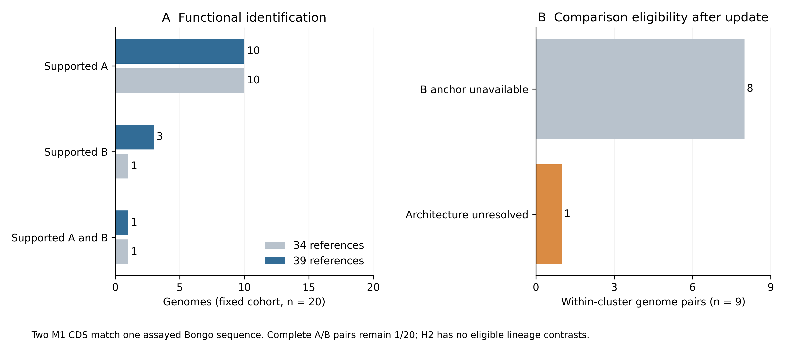

# Assay-reference follow-up

Five additional assayed reference proteins improve LysB-family identification in the same 20-genome cohort. Supported B coverage increases from 1/20 to 3/20 genomes at unchanged numerical thresholds. Supported A coverage remains 10/20, and D29 remains the only complete supported A/B pair. The [fixed protocol](lysterase_update_protocol.md) defines this exploratory follow-up.

## Reference evidence and assignment changes

The [reference ledger](../references/lysterase_2026_expansion.tsv) adds five Table 1 proteins from [Maneekul et al. (2026)](https://doi.org/10.1128/jb.00410-26). All six source translations verify; the study's D29 protein is an exact sequence alias of the existing D29 reference. The [source ledger](../results/lysterase_update/curation/source_sequences.tsv) records accession versions and checksums.

| Measurement | Combined panel | Assay-updated panel |
|---|---:|---:|
| Reference proteins | 34 | 39 |
| Genomes with supported A | 10 | 10 |
| Genomes with supported B | 1 | 3 |
| Genomes with supported A and B | 1 | 1 |
| Supported proteins | 12 | 14 |
| Supported separated architectures | 0 | 0 |
| Eligible primary H2 lineage contrasts | 0 | 0 |

Glaske16 WNN95621.1 and IPhane7 AXQ52679.1 become moderate-confidence B-family assignments. Both encode exactly the Bongo reference sequence, including full-length identity and coverage. They therefore represent two genomic occurrences of one assayed protein sequence, rather than two independently characterized enzymes. Both had already passed the original broad and narrow HMM candidate criteria; the new support comes from the assayed reference, rather than upgrading confidence from genomic context. [Assignment changes](../results/lysterase_update/comparison/confidence_changes.tsv).

The new reference tier is capped at moderate because activity against mycobacteria does not independently demonstrate native mycolate-substrate cleavage or a requirement during phage infection. The previous supported calls are retained. No independent complete A assignment is recovered in either M1 genome, and their primary architectures remain unresolved.

The [complete alignment ledger](../results/lysterase_update/search_evidence/all_cohort_reference_hits.tsv) retains every reported cohort-reference hit. The [per-CDS detection table](../results/lysterase_update/search_evidence/protein_detection_status.tsv) distinguishes accepted assignments, weak matches and no reported match for all 2,460 CDS; non-detection does not establish gene absence.

## Held-out recovery

Four of the five new B reference queries recover their expected category after source and exact-sequence exclusions. Bongo does not: its best remaining category match has 35.2% identity to Ms6 LysB, below the fixed 40% threshold despite more than 97% coverage of both sequences. This observed failure illustrates a reference-coverage limitation. It does not establish a population sensitivity estimate. The complete query and alignment ledgers retain all non-recovered queries and selected cellular-enzyme challenges.

None of the three selected cellular-enzyme challenges receives an accepted lysis-family label. This small selected set cannot estimate a population false-discovery rate. [All query outcomes](../results/lysterase_update/reference_validation/query_summary.tsv), [alignment evidence](../results/lysterase_update/reference_validation/alignment_evidence.tsv) and [validation summary](../results/lysterase_update/reference_validation/validation_summary.json).

## Neighborhood eligibility

The updated panel supplies supported B anchors in both genomes of one within-cluster pair, Glaske16–IPhane7. That pair remains ineligible because its A/B architectures are unresolved. The other eight within-cluster pairs lack supported B anchors. There are no eligible primary H2 pairs or lineage contrasts, and no conservation effect, interval or p-value can be estimated. Additional B identification has improved evidence coverage without resolving the planned evolutionary comparison. Expansion remains gated.



The [comparison table](../results/lysterase_update/comparison/panel_summary.tsv), [pair eligibility ledger](../results/lysterase_update/comparison/primary_pair_eligibility.tsv), [vector figure](../results/lysterase_update/comparison/reference_update.pdf) and [caption/source manifest](../results/lysterase_update/comparison/comparison_manifest.json) support the displayed result. The updated panel contains six additional figure pairs and all 27 pipeline tables; earlier panel outputs remain separately frozen.

## Reproduction

With the pinned software installed, retrieve the small accessioned reference records and reproduce the frozen-cohort analysis:

```sh
python -B scripts/curate_lysterase_update.py
python -B scripts/run_lysterase_update.py --no-export
python -B scripts/reference_validation.py \
  --root .experiments/lysterase_2026 \
  --out .experiments/lysterase_2026_validation
python -B scripts/archive_cohort_hits.py \
  --root .experiments/lysterase_2026 \
  --out .experiments/lysterase_2026_search_evidence
python -B scripts/summarize_lysterase_update.py
```

The pipeline checks source hashes and compares all 39 regenerated scientific artifacts with the published panel. `--offline` requires the corresponding acquired records; a new replay workspace can be selected with `--workspace`. This reproduces the fixed cohort rather than resampling the original eligibility population. The original profile diagnostic and three earlier scientific panels are separate analyses.

A second independent workspace reproduced all 39 scientific artifacts byte-for-byte using checksum-verified source records and newly rebuilt family clustering. This checks execution from fixed inputs and pinned software; it does not independently reinstall the software or establish biological function.
