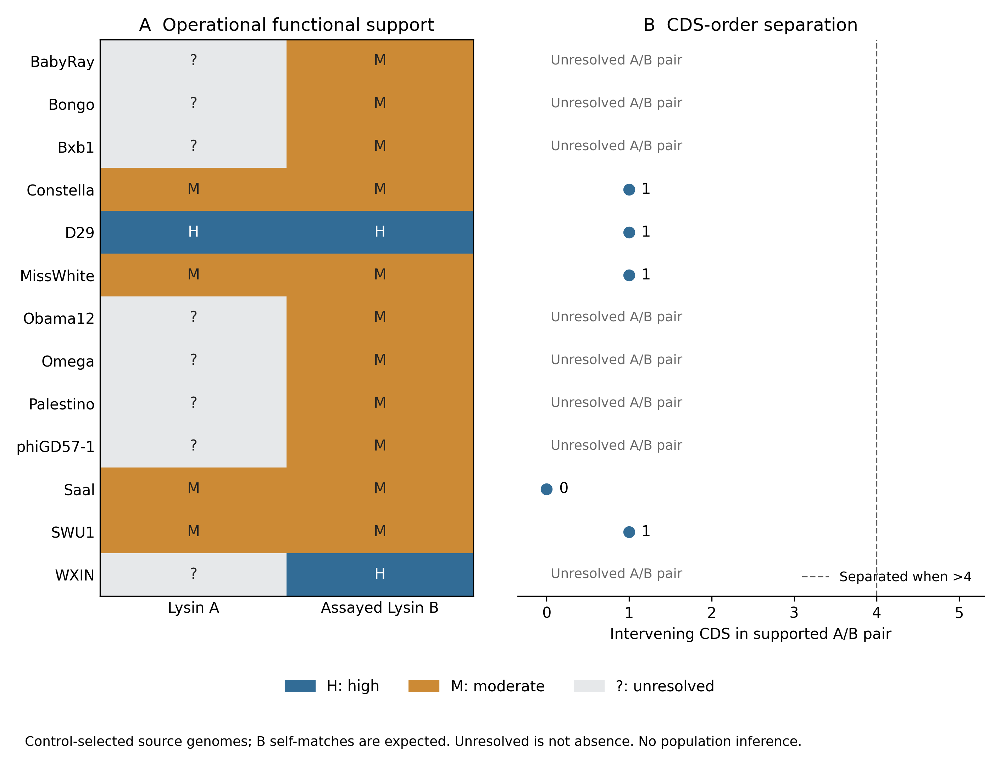

# Architecture of assay-reference source genomes

Five of thirteen complete source genomes have a unique supported A/B pair under the fixed 39-reference rules. All five pairs are closely linked. The remaining eight have supported B but no supported A assignment. This control-selected survey adds canonical arrangements for inspection, but no supported displaced control and no primary neighborhood contrast.

## Sources and observations

All fourteen resolved nucleotide sources supplying the assay-profile B references were considered. The Ms6 record AF319619.1 is a 6,173 bp lysis locus and fails whole-genome eligibility; it remains a functional reference. Thirteen complete records pass pipeline QC, containing 1,649 verified CDS translations. None is excluded by the subsequent duplicate screen. Missing host genera and cluster labels remain unavailable. [Source-selection ledger](../results/reference_architecture_controls/source_selection.tsv), [dataset manifest](../results/reference_architecture_controls/tables/dataset_manifest.tsv).

| Source phage | Supported A/B architecture | Intervening CDS | Edge gap, bp |
|---|---|---:|---:|
| D29 | Closely linked | 1 | 418 |
| SWU1 | Closely linked | 1 | 388 |
| MissWhite | Closely linked | 1 | 394 |
| Saal | Closely linked | 0 | 0 |
| Constella | Closely linked | 1 | 376 |

Bxb1, Omega, Obama12, BabyRay, Palestino, phiGD57-1, Bongo and WXIN remain unresolved because their A proteins do not meet the operational support criteria. This is incomplete identification, not evidence of A loss. All thirteen assayed B sequences resolve uniquely to the expected translated CDS. Their source self-matches are expected; the preferred evidence row can instead name a different characterized homolog when it gives stronger support at the same confidence tier. These recoveries are not independent sensitivity estimates. [Full architecture summary](../results/reference_architecture_controls/architecture_summary.tsv), [source-protein recovery](../results/reference_architecture_controls/assayed_source_recovery.tsv), [all reported reference alignments](../results/reference_architecture_controls/reported_reference_alignments.tsv).



The four additional supported pairs supplement the D29 arrangement; D29 also appears in the original cohort under its primary GenBank accession. The four pairs have moderate homology support, rather than independent biochemical characterization of both components. All five remain linked at cutoffs 2, 4, 6 and 10. The high-only scope retains only D29. Full component pairs, deposited-label classifications and confidence/threshold sensitivities are retained in the [survey tables](../results/reference_architecture_controls/tables/architecture_sensitivity.tsv).

## Scope and interpretation

The [protocol](reference_architecture_protocol.md) specifies every assay source independently of gene positions. The input-check amendment recognizes explicit organism or PHG classification when a RefSeq definition uses “virus.” It restores eligibility of D29 NC_001900.2 without changing completeness or translation criteria. Re-extraction with the corrected check leaves both frozen 20-genome QC tables byte-identical, including all 2,460 CDS.

No source was added because its arrangement was favorable. This collection was selected for assayed B proteins, so neither the five linked observations nor the eight unresolved outcomes estimate population frequencies. Source self-matches, generic esterase activity and antimycobacterial assays retain their stated evidence limitations. The absence of a supported separated arrangement in this collection cannot establish its absence elsewhere.

Only acquisition, QC, reference search, evidence extraction and architecture were executed. No family clustering, ancestry reconstruction, neighborhood hypothesis test or larger population cohort is claimed. The original cohort, its primary H2 result and the expansion gate are unchanged. Additional linked controls do not resolve the missing independently supported displaced comparison.

## Reproduction

First acquire and reproduce the 39-reference panel as described in the [assay-reference results](lysterase_update_results.md). The survey authenticates acquired source records against that frozen manifest and runs offline in a fresh isolated workspace. Existing workspaces and exported results are preserved. Reproduce and compare all survey artifacts with:

```sh
python -B scripts/survey_reference_architectures.py \
  --workspace reference_source_rescan --no-export
python -B scripts/compare_reference_architectures.py \
  --workspace reference_source_rescan --output reference_source_rescan_export
```

The [artifact manifest](../results/reference_architecture_controls/artifact_manifest.json) and [figure manifest](../results/reference_architecture_controls/comparison/figure_manifest.json) authenticate source tables and figures. The source-record acquisition and installed environment are reused in this scientific replay.

`python -B scripts/summarize_reference_architectures.py` regenerates the figure from the authenticated published source tables.
